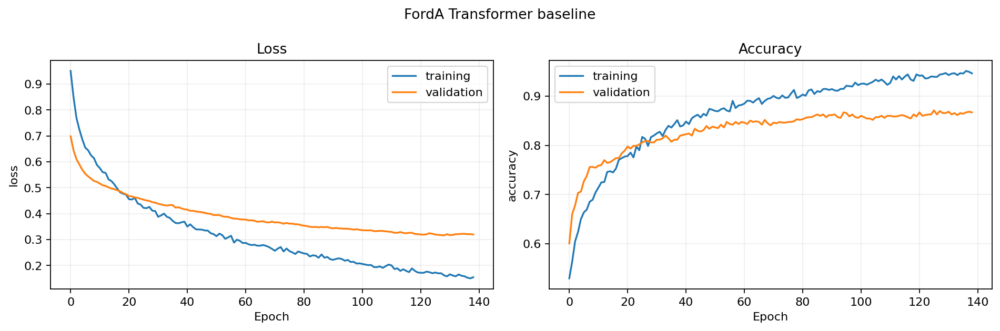
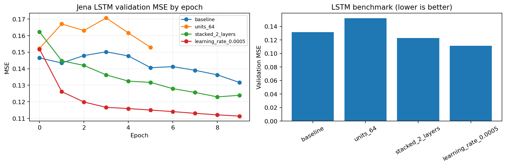

# CMPE 401 — Instructor-defined Project 2

**Time Series Modelling with Deep Learning: Transformer Classification and LSTM Forecasting**

This project implements and evaluates two deep learning approaches for time-series analysis based on official Keras examples: Transformer-based classification on the FordA dataset and LSTM-based forecasting on the Jena Climate dataset. Three controlled modifications to the LSTM baseline are evaluated to examine their effects on predictive performance. The repository includes the implementation, experimental results, visualizations, and reproducibility instructions.

## Project objectives and deliverables

1. Run a Transformer-style network on the FordA binary classification task.
2. Run the LSTM weather-forecasting baseline on Jena Climate.
3. Evaluate three distinct LSTM modifications against the same baseline.
4. Document dataset, input/output, architecture, training, quantitative results, and observations.
5. Answer the instructor’s two reflection questions.

## Results at a glance

- **FordA Transformer-style classification:** test accuracy **86.29%**; test cross-entropy loss **0.3268**; best validation accuracy **87.10%**; 139 epochs.
- **Jena LSTM baseline:** validation MSE **0.13166**, validation MAE **0.28525**.
- **Best tested LSTM configuration:** learning rate 0.0005; validation MSE **0.11136**, validation MAE **0.26270**; MSE reduction relative to baseline **15.42%**.

> **Metrics caution:** FordA reports held-out **test** accuracy, whereas the Keras-style Jena workflow reports **validation** MSE/MAE (no independent test set). The two problems and metrics are not directly comparable. Jena targets were standardized using training-set statistics, so MAE/MSE here are measured in normalized units, not °C.

## Data, modelling, and evaluation

### Task A — FordA / time-series classification

- **Task:** assign each engine sensor trace to one of two classes, using 500 sequential scalar measurements.
- **Data:** original FordA training partition (3,601 examples) with 20% of training data reserved for validation; original held-out test partition (1,320 examples). Source labels −1 and 1 are remapped to 0 and 1; training examples are shuffled with seed 42.
- **Model:** four Keras-example Transformer encoder blocks (multi-head attention, residual connections, normalization, 1×1 convolution feed-forward layers), followed by Flatten, Dense(128), dropout, and a two-class softmax head.
- **Training:** Adam (learning rate 1e−4), sparse categorical cross-entropy, batch size 64, at most 150 epochs, early stopping on validation loss (patience 10, restoring best weights).
- **Evaluation:** held-out test accuracy and cross-entropy; training/validation loss and accuracy plots.

**Documented deviation from the public Keras example:** The public example currently uses `GlobalAveragePooling1D(data_format="channels_last")`, which reduces a `(500, 1)` sequence to one scalar. This notebook uses `Flatten()` so the 500 time points reach the classification head. **Consequently, this is an adapted Keras example, not an exact reproduction of its current published head.** A single input channel together with per-timestep LayerNormalization may also constrain what the attention branches can learn; the reported classification score should not be interpreted as a direct measurement of attention effectiveness.

### Task B — Jena Climate / time-series forecasting

- **Task:** forecast future temperature using a historical multivariate weather sequence.
- **Data:** Jena 2009–2016 10-minute measurements; seven input features: pressure, temperature, saturation vapor pressure, vapor pressure deficit, specific humidity, air density, and wind speed.
- **Input:** `(120, 7)` — 120 samples at one-hour intervals (five days). The target is standardized future temperature, using a 12-hour forecasting horizon beyond the observed window, following the Keras tutorial index construction.
- **Preprocessing:** chronological 71.5%/28.5% training/validation split; featurewise standardization fitted on training rows only.
- **Baseline:** LSTM(32) → Dense(1), Adam(0.001), batch size 256, MSE training loss, MAE evaluation metric. Up to 10 epochs, early stopping on validation loss with patience 5 and best-weights restoration.
- **Evaluation:** validation MSE, validation MAE, trainable parameter counts, elapsed training time. All configurations use the same preprocessing and split.

## Three controlled modifications and benchmark

Each run changes exactly one model or optimizer setting relative to LSTM(32) baseline. The same seed (42), dataset split, batch size, maximum-epoch budget, validation metric, and early-stopping rule were used. Actual epoch counts can differ because early stopping is enabled.

| Configuration | Hidden units | Layers | Learning rate | Val MSE ↓ | Val MAE ↓ | Parameters | Epochs | Time (s) |
|---|---:|---:|---:|---:|---:|---:|---:|---:|
| Baseline | 32 | 1 | 0.0010 | 0.13166 | 0.28525 | 5,153 | 10 | 598.5 |
| 64 hidden units | 64 | 1 | 0.0010 | 0.15226 | 0.30492 | 18,497 | 6 | 345.7 |
| Two LSTM layers | 32 | 2 | 0.0010 | 0.12298 | 0.27423 | 13,473 | 10 | 622.0 |
| **Learning rate 0.0005 (best)** | 32 | 1 | 0.0005 | 0.11136 | 0.26270 | 5,153 | 10 | 562.5 |

### Interpretation

- **More hidden units (32 → 64)** increased model capacity from 5,153 to 18,497 parameters, but validation MSE **worsened** from 0.13166 to 0.15226 (15.65% higher). More parameters did not automatically improve generalization on this run.
- **Stacking two LSTM layers** improved validation MSE to 0.12298, a **6.59% reduction** from the baseline, with 13,473 parameters.
- **Lowering the Adam learning rate (0.001 → 0.0005)** gave the lowest validation MSE, 0.11136, a **15.42% reduction** compared with the baseline. Validation MAE also decreased by **7.90%**.
- These observations are from one training run per configuration and should not be treated as universal rankings.

### Recorded figures





## Instructor Questions and Reflections

**1. Which model did you find easier to understand and why?**

I found the LSTM baseline easier to understand because its main architecture is one recurrent layer followed by a single output unit for future temperature. The sequence-to-one prediction is easy to trace. By contrast, the Transformer example includes multiple attention heads, residual paths, normalization, and encoder blocks, which take more effort to follow.

**2. What improvement did you try, and what did you learn from it?**

I compared three changes to the LSTM baseline: 64 instead of 32 hidden units, a second LSTM layer, and a smaller learning rate of 0.0005. The smaller learning rate produced the lowest validation MSE (0.11136, versus 0.13166 for the baseline), an improvement of 15.42%. Stacking layers also helped, but increasing units alone made the validation error worse. I learned that controlled evaluation matters more than simply making a model larger.

## Reproduce the experiment

### Google Colab (recommended)

1. Open Google Colab and upload [`CMPE401_Project2.ipynb`](CMPE401_Project2.ipynb).
2. Under **Runtime → Change runtime type**, choose a GPU runtime (such as T4), if available.
3. Confirm `RUN_MODE = "full"` (the notebook defaults to full if `CMPE401_MODE` is not set).
4. Choose **Runtime → Run all**. The code downloads FordA and Jena datasets, fits the two baseline models and three LSTM variants, and saves metrics and figures.
5. Download the generated `CMPE401_Project2_outputs.zip` from the last cell and put its contents into the `outputs/` directory. The output files in this repository were produced from an actual full run.

### Python script

```bash
python -m pip install -r requirements.txt
python run_project.py
```

The Colab notebook and Python script provide full source code plus instructions for **reproducing** trained models. Trained weight checkpoints are not included. For a quick pipeline check only, set `CMPE401_MODE=smoke` before running the script; **smoke runs are not valid substitutes for these full experiment results**.

## Repository contents

```text
CMPE401_Project2.ipynb         # Source notebook (Colab)
run_project.py                # Source script
requirements.txt              # Python dependencies
README.md                     # Project documentation and benchmark
outputs/
  transformer_baseline.json   # Held-out FordA scores
  transformer_learning_curves.png
  lstm_benchmark.csv          # Four measured forecasting runs
  lstm_benchmark.png
  PROJECT_SUMMARY.md          # Raw auto-generated text summary
```

## Limitations / research integrity

- Model architectures and datasets originate from **official Keras examples**, with the documented FordA classification-head adaptation; no claim of original model invention is made.
- The Jena tutorial and this project use validation rather than independent test metrics; these values should **not** be labeled test-set results.
- Jena labels are standardized, so MSE and MAE are not directly in degrees Celsius.
- One seed and one run per LSTM configuration limit how broadly we can generalize the results; different seeds or software/hardware versions may produce different scores.
- Training times are machine-specific and should not be taken as intrinsic model speed rankings.

## References

- Ntakouris, T. (2021). [Timeseries classification with a Transformer model](https://keras.io/examples/timeseries/timeseries_classification_transformer/). Keras Examples.
- Attri, P., Sharma, Y., Takach, K., & Shah, F. (2020; updated 2023). [Timeseries forecasting for weather prediction](https://keras.io/examples/timeseries/timeseries_weather_forecasting/). Keras Examples.
- FordA dataset (via [hfawaz/cd-diagram](https://github.com/hfawaz/cd-diagram/tree/master/FordA)).
- Jena Climate dataset (Max Planck Institute for Biogeochemistry; [Keras dataset mirror](https://storage.googleapis.com/tensorflow/tf-keras-datasets/jena_climate_2009_2016.csv.zip)).
