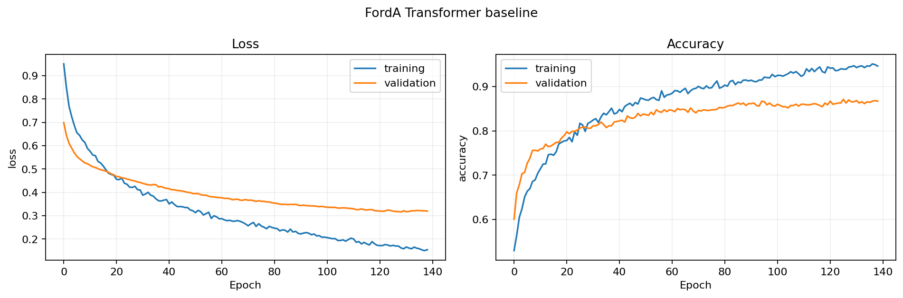
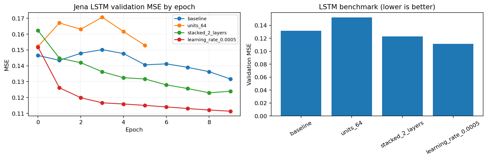

# CMPE 401 Project 2 — Experiment Summary

**Execution mode:** `full`

## Task 1 — Baseline reproduction
- **Transformer / FordA:** input [500, 1]; 93,130 parameters; 139 epochs; test accuracy **0.8629**; test cross-entropy loss **0.3268**.
- **LSTM / Jena Climate:** input (120, 7); baseline LSTM(32); 5,153 parameters; validation MSE **0.1317**; validation MAE **0.2852**.

## Task 2 and 3 — Controlled modifications / benchmark

| Experiment | Hidden units | LSTM layers | Learning rate | Val MSE | Val MAE | Params | Training (s) |
|---|---:|---:|---:|---:|---:|---:|---:|
| baseline | 32 | 1 | 0.0010 | 0.1317 | 0.2852 | 5,153 | 598.5 |
| units_64 | 64 | 1 | 0.0010 | 0.1523 | 0.3049 | 18,497 | 345.7 |
| stacked_2_layers | 32 | 2 | 0.0010 | 0.1230 | 0.2742 | 13,473 | 622.0 |
| learning_rate_0.0005 | 32 | 1 | 0.0005 | 0.1114 | 0.2627 | 5,153 | 562.5 |

The three experiments change one hyperparameter/architectural choice at a time. The Transformer and LSTM scores are **not directly comparable**, because they use different datasets and tasks.

## Task 4 — Questions (draft answers; review in your own words)

### Q1. Which model did you find easier to understand and why?
**Suggested personal response:** I found the LSTM model easier to understand because the Keras baseline uses a single LSTM layer followed by one Dense output layer. It also directly connects a sequence of weather measurements to a single future temperature, whereas the Transformer contains multiple attention and residual blocks. [Edit this to match your experience.]

### Q2. What improvement did you try, and what did you learn from it?
I tested three independent changes: 64 hidden units, two stacked LSTM layers, and a learning rate of 0.0005. The modified run with the lowest validation MSE was **learning_rate_0.0005** (reducing the learning rate from 0.001 to 0.0005). It improved validation MSE relative to the baseline by **15.42%** (baseline 0.1317; modified 0.1114). This shows that model settings should be evaluated empirically rather than assuming more complexity is always beneficial.

## Figures

## Limitations
- The official Jena tutorial provides training and validation splits but no independent test split. Reported forecasting scores are validation metrics.
- Results may differ between runs or hardware/software versions despite setting a seed.
- These are single-seed experiments; repeated-seed evaluation would strengthen conclusions.

## Sources
- Transformer: https://keras.io/examples/timeseries/timeseries_classification_transformer/
- LSTM: https://keras.io/examples/timeseries/timeseries_weather_forecasting/
